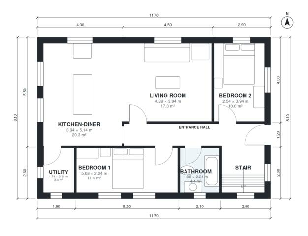

# Dormer Bungalow Plans: 4 Bed, 2 Bath, 1,590 Sq Ft Home

This is a compact dormer bungalow of about 143 m² of living space on an 11.7 x 8.1 m footprint, with no garage and no basement. The ground floor has an entrance hall, a kitchen-diner open to the living room, two bedrooms, a bathroom, a utility room and the stair. Two more bedrooms and a shower room sit upstairs, reached from a landing. Both ground-floor bedrooms are a little narrow, and the utility and shower room are slightly small, so we can adjust those if you like.

| | |
|---|---|
| Levels | 2 |
| Footprint | 11.7 m × 8.1 m (38 ft × 27 ft) |
| Rooms | 13 indoor, 1 outdoor |
| Indoor area including garage, from the room grid | about 147 m² (1,587 sq ft) |

## Files here

- `area-schedule.csv` (room schedule)
- `building.json` (rooms, walls, openings as data)
- `plan-level1.dxf` (floor plan, DXF, drawing units: millimetres)
- `plan-level2.dxf` (floor plan, DXF, drawing units: millimetres)

## More for this plan

- Plan page with the PDF plan set, IFC and 3D model, and a tool to change the plan: https://floorplan.ai-architectures.com/house-plans/dormer-bungalow-plans?utm_source=github-plans&utm_medium=probe&utm_campaign=github
- PDF plan set: https://storage.googleapis.com/20img/house-plans/dormer-bungalow-plans/plan-set.pdf
- IFC model: https://storage.googleapis.com/20img/house-plans/dormer-bungalow-plans/model.ifc

## Known issues in this drawing

- Bedroom 1 is only 2.24 m wide.

Concept design generated with AI. Not for construction or permit; verify with a licensed professional.
