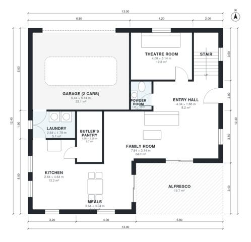

# Double Storey House Plans: 4 Bed, 2.5 Bath, 2,560 sq ft

A compact two-storey 4-bedroom home of about 230 m² of living space (garage excluded) on a 13 x 12.4 m footprint. Downstairs has an open kitchen with butler's pantry, family and meals areas opening to an alfresco, a theatre, a powder room and a laundry that connects to the 2-car garage. Upstairs are the master suite with walk-in robe and ensuite, three bedrooms, a bathroom and a rumpus room that opens to a new terrace.

| | |
|---|---|
| Levels | 2 |
| Footprint | 13.0 m × 12.4 m (43 ft × 41 ft) |
| Rooms | 20 indoor, 2 outdoor |
| Indoor area including garage, from the room grid | about 275 m² (2,961 sq ft) |

## Files here

- `area-schedule.csv` (room schedule)
- `building.json` (rooms, walls, openings as data)
- `plan-level1.dxf` (floor plan, DXF, drawing units: millimetres)
- `plan-level2.dxf` (floor plan, DXF, drawing units: millimetres)

## More for this plan

- Plan page with the PDF plan set, IFC and 3D model, and a tool to change the plan: https://floorplan.ai-architectures.com/house-plans/double-storey-house-plans?utm_source=github-plans&utm_medium=probe&utm_campaign=github
- PDF plan set: https://storage.googleapis.com/20img/house-plans/double-storey-house-plans/plan-set.pdf
- IFC model: https://storage.googleapis.com/20img/house-plans/double-storey-house-plans/model.ifc

## Known issues in this drawing

- None found by the automatic checks.

Concept design generated with AI. Not for construction or permit; verify with a licensed professional.
