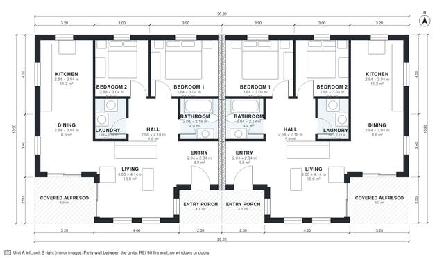

# Dual Occupancy House Plans: 4 Bed, 2 Bath, 1,960 Sq Ft

Each of the two mirrored single-storey dwellings is about 10.1 × 10.2 m, or about 103 m² including the entry porch and covered alfresco, and the building is about 206 m² in total. The party wall is on the east side, with no openings in it. Each unit has its own entry porch, open kitchen/dining/living with the alfresco at the rear corner, two bedrooms along the north wall, a central hall serving the bathroom and laundry, and windows on the free sides. Two mirrored units side by side, each with its own entrance, kitchen, bathrooms and stair where there are upper floors; the party wall between them is a fire wall without openings.

| | |
|---|---|
| Levels | 1 |
| Footprint | 20.2 m × 10.2 m (66 ft × 33 ft) |
| Rooms | 18 indoor, 4 outdoor |
| Indoor area including garage, from the room grid | about 182 m² (1,956 sq ft) |

## Files here

- `area-schedule.csv` (room schedule)
- `building.json` (rooms, walls, openings as data)
- `plan-level1.dxf` (floor plan, DXF, drawing units: millimetres)

## More for this plan

- Plan page with the PDF plan set, IFC and 3D model, and a tool to change the plan: https://floorplan.ai-architectures.com/house-plans/dual-occupancy-house-plans?utm_source=github-plans&utm_medium=probe&utm_campaign=github
- PDF plan set: https://storage.googleapis.com/20img/house-plans/dual-occupancy-house-plans/plan-set.pdf
- IFC model: https://storage.googleapis.com/20img/house-plans/dual-occupancy-house-plans/model.ifc

## Known issues in this drawing

- Kitchen and Laundry are not directly connected.
- Kitchen and Laundry are not directly connected.

Concept design generated with AI. Not for construction or permit; verify with a licensed professional.
