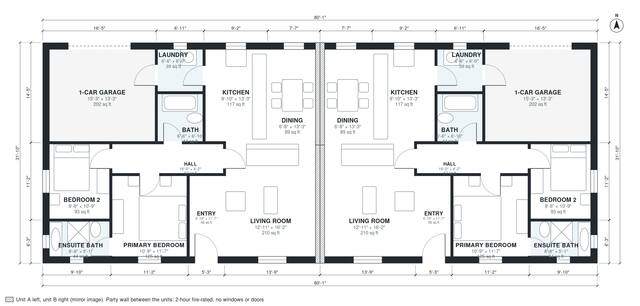

# Duplex House Plans With Garage: 4 Bed, 4 Bath, 2,070 Sq Ft

This is a single-story duplex of two mirrored units sharing a fire-rated party wall. Each unit has about 1,050 sq ft of living space, or 2,100 sq ft for both, with garages extra. Each unit has its own entry, an open kitchen, dining and living area, two bedrooms, two baths, a laundry room and a 1-car garage. The private bedroom wing is kept apart from the open living area, and the garage connects to the house through the laundry. Two mirrored units side by side, each with its own entrance, kitchen, bathrooms and stair where there are upper floors; the party wall between them is a fire wall without openings.

| | |
|---|---|
| Levels | 1 |
| Footprint | 24.4 m × 9.7 m (80 ft × 32 ft) |
| Rooms | 22 indoor, 0 outdoor |
| Indoor area including garage, from the room grid | about 237 m² (2,548 sq ft) |

## Files here

- `area-schedule.csv` (room schedule)
- `building.json` (rooms, walls, openings as data)
- `plan-level1.dxf` (floor plan, DXF, drawing units: inches)

## More for this plan

- Plan page with the PDF plan set, IFC and 3D model, and a tool to change the plan: https://floorplan.ai-architectures.com/house-plans/duplex-house-plans-with-garage?utm_source=github-plans&utm_medium=probe&utm_campaign=github
- PDF plan set: https://storage.googleapis.com/20img/house-plans/duplex-house-plans-with-garage/plan-set.pdf
- IFC model: https://storage.googleapis.com/20img/house-plans/duplex-house-plans-with-garage/model.ifc

## Known issues in this drawing

- Ensuite Bath is 4.1 m² (asked for about 5.5 m²).
- Dining is only 2.04 m wide.
- Ensuite Bath is 4.1 m² (asked for about 5.5 m²).
- Dining is only 2.04 m wide.

Concept design generated with AI. Not for construction or permit; verify with a licensed professional.
