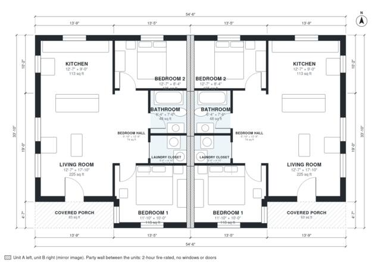

# Duplex House Plans: 1,710 Sq Ft, 4 Bed, 2 Bath One-Story

A single-story mirrored duplex. Each unit is about 8.3 x 10.3 m (about 920 sq ft including the 4'-7" covered porch), so the building totals about 1,850 sq ft. Each unit has its own front porch and entry, an open kitchen and living area at the back and front, two bedrooms and a bath off a short hall, and a laundry closet. The shared party wall has no openings, so all daylight comes from the front, back and outer side. Two mirrored units side by side, each with its own entrance, kitchen, bathrooms and stair where there are upper floors; the party wall between them is a fire wall without openings.

| | |
|---|---|
| Levels | 1 |
| Footprint | 16.6 m × 10.3 m (54 ft × 34 ft) |
| Rooms | 14 indoor, 2 outdoor |
| Indoor area including garage, from the room grid | about 159 m² (1,714 sq ft) |

## Files here

- `area-schedule.csv` (room schedule)
- `building.json` (rooms, walls, openings as data)
- `plan-level1.dxf` (floor plan, DXF, drawing units: inches)

## More for this plan

- Plan page with the PDF plan set, IFC and 3D model, and a tool to change the plan: https://floorplan.ai-architectures.com/house-plans/duplex-house-plans?utm_source=github-plans&utm_medium=probe&utm_campaign=github
- PDF plan set: https://storage.googleapis.com/20img/house-plans/duplex-house-plans/plan-set.pdf
- IFC model: https://storage.googleapis.com/20img/house-plans/duplex-house-plans/model.ifc

## Known issues in this drawing

- None found by the automatic checks.

Concept design generated with AI. Not for construction or permit; verify with a licensed professional.
