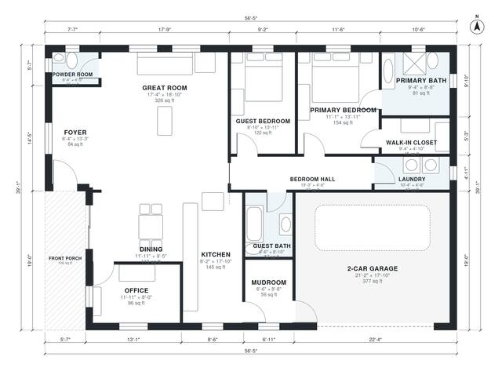

# Empty Nester House Plans: 2-Bed Single-Story, 1,670 Sq Ft

A single-story farmhouse-style ranch of about 157 m² (1,690 sq ft) of living space, plus a 2-car garage and a covered front porch. It has an open kitchen, dining and great room, an office off the foyer, and a private primary suite with bath and walk-in closet. A guest bedroom and bath share a bedroom hall, and the laundry and mudroom sit between the kitchen and garage. The revision makes the bedroom hall a direct door off the great room, moves the laundry to the mudroom side, and widens the guest bath and foyer.

| | |
|---|---|
| Levels | 1 |
| Footprint | 17.2 m × 11.9 m (56 ft × 39 ft) |
| Rooms | 15 indoor, 1 outdoor |
| Indoor area including garage, from the room grid | about 195 m² (2,097 sq ft) |

## Files here

- `area-schedule.csv` (room schedule)
- `building.json` (rooms, walls, openings as data)
- `plan-level1.dxf` (floor plan, DXF, drawing units: inches)

## More for this plan

- Plan page with the PDF plan set, IFC and 3D model, and a tool to change the plan: https://floorplan.ai-architectures.com/house-plans/empty-nester-house-plans?utm_source=github-plans&utm_medium=probe&utm_campaign=github
- PDF plan set: https://storage.googleapis.com/20img/house-plans/empty-nester-house-plans/plan-set.pdf
- IFC model: https://storage.googleapis.com/20img/house-plans/empty-nester-house-plans/model.ifc

## Known issues in this drawing

- Foyer and Office are not directly connected.

Concept design generated with AI. Not for construction or permit; verify with a licensed professional.
