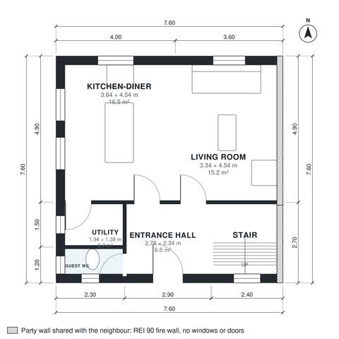

# End of Terrace House Plans: 3-Bed, 1,240 Sq Ft Two-Story Plan

This is a 6.5 m wide, two-storey end-of-terrace house of about 115 m² (1,240 sq ft), with the party wall on the right and windows on the other three sides. Downstairs, an entrance hall leads to a large open kitchen-diner and living room, a guest WC and a utility room off the kitchen. Upstairs, a central landing serves three bedrooms and a family bathroom, and each bedroom has its own window. Bedroom 3 is compact and works best as a single room or home office. Built against the neighbours on the right (party wall, fire wall without windows or doors); the rooms take their daylight from the free sides.

| | |
|---|---|
| Levels | 2 |
| Footprint | 7.6 m × 7.6 m (25 ft × 25 ft) |
| Rooms | 12 indoor, 0 outdoor |
| Indoor area including garage, from the room grid | about 116 m² (1,243 sq ft) |

## Files here

- `area-schedule.csv` (room schedule)
- `building.json` (rooms, walls, openings as data)
- `plan-level1.dxf` (floor plan, DXF, drawing units: millimetres)
- `plan-level2.dxf` (floor plan, DXF, drawing units: millimetres)

## More for this plan

- Plan page with the PDF plan set, IFC and 3D model, and a tool to change the plan: https://floorplan.ai-architectures.com/house-plans/end-of-terrace-house-plans?utm_source=github-plans&utm_medium=probe&utm_campaign=github
- PDF plan set: https://storage.googleapis.com/20img/house-plans/end-of-terrace-house-plans/plan-set.pdf
- IFC model: https://storage.googleapis.com/20img/house-plans/end-of-terrace-house-plans/model.ifc

## Known issues in this drawing

- Bedroom 2 is only 2.14 m wide.

Concept design generated with AI. Not for construction or permit; verify with a licensed professional.
