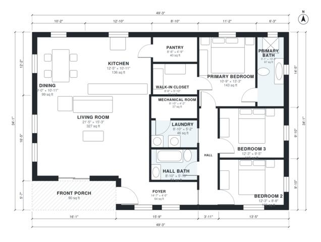

# Energy Efficient House Plans: 3 Bed, 2 Bath, 1,590 Sq Ft

This is a compact single-story ranch of about 156 m² (roughly 1,680 sq ft), with three bedrooms and two baths. It has an open kitchen, dining and living area, a front porch, a laundry, a mechanical room and a pantry. The primary suite has its own bath and walk-in closet, and the other two bedrooms share a hall bath. All three bedrooms sit off one hall, away from the living space.

| | |
|---|---|
| Levels | 1 |
| Footprint | 15.0 m × 10.4 m (49 ft × 34 ft) |
| Rooms | 14 indoor, 1 outdoor |
| Indoor area including garage, from the room grid | about 148 m² (1,590 sq ft) |

## Files here

- `area-schedule.csv` (room schedule)
- `building.json` (rooms, walls, openings as data)
- `plan-level1.dxf` (floor plan, DXF, drawing units: inches)

## More for this plan

- Plan page with the PDF plan set, IFC and 3D model, and a tool to change the plan: https://floorplan.ai-architectures.com/house-plans/energy-efficient-house-plans?utm_source=github-plans&utm_medium=probe&utm_campaign=github
- PDF plan set: https://storage.googleapis.com/20img/house-plans/energy-efficient-house-plans/plan-set.pdf
- IFC model: https://storage.googleapis.com/20img/house-plans/energy-efficient-house-plans/model.ifc

## Known issues in this drawing

- None found by the automatic checks.

Concept design generated with AI. Not for construction or permit; verify with a licensed professional.
