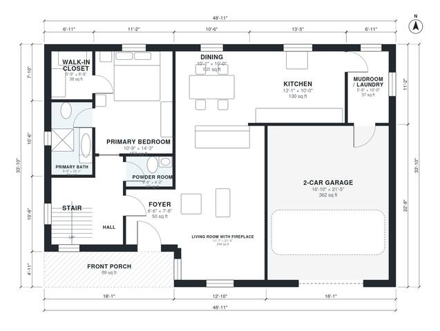

# English Cottage House Plans | 3 Bed, 2.5 Bath, 1,910 Sq Ft

This is a story-and-a-half English cottage of about 167 m² (1,800 sq ft) of living space, plus a 36 m² two-car garage and a front porch. The ground floor has the living room with fireplace, open dining and kitchen, a mudroom/laundry off the garage, and a main-floor primary suite with bath and walk-in closet. Two bedrooms and a bath sit upstairs. I'm adjusting the hall so the stair and primary suite are reached from the entry rather than through the mudroom.

| | |
|---|---|
| Levels | 2 |
| Footprint | 14.9 m × 10.3 m (49 ft × 34 ft) |
| Rooms | 18 indoor, 2 outdoor |
| Indoor area including garage, from the room grid | about 215 m² (2,317 sq ft) |

## Files here

- `area-schedule.csv` (room schedule)
- `building.json` (rooms, walls, openings as data)
- `plan-level1.dxf` (floor plan, DXF, drawing units: inches)
- `plan-level2.dxf` (floor plan, DXF, drawing units: inches)

## More for this plan

- Plan page with the PDF plan set, IFC and 3D model, and a tool to change the plan: https://floorplan.ai-architectures.com/house-plans/english-cottage-house-plans?utm_source=github-plans&utm_medium=probe&utm_campaign=github
- PDF plan set: https://storage.googleapis.com/20img/house-plans/english-cottage-house-plans/plan-set.pdf
- IFC model: https://storage.googleapis.com/20img/house-plans/english-cottage-house-plans/model.ifc

## Known issues in this drawing

- None found by the automatic checks.

Concept design generated with AI. Not for construction or permit; verify with a licensed professional.
