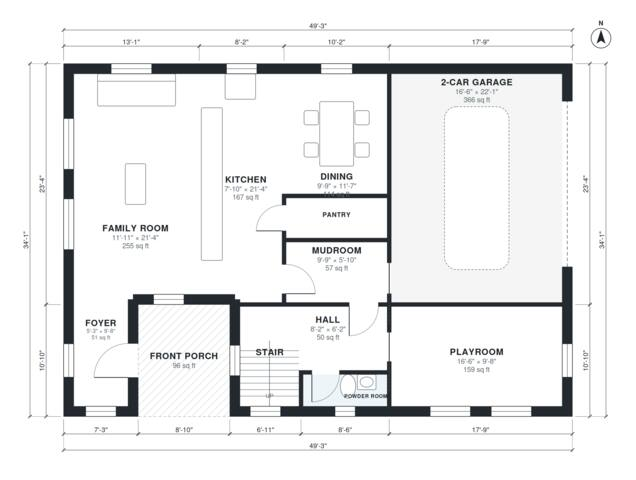

# Family House Plans: 4-Bed, 2.5-Bath Two-Story, 2,290 Sq Ft

A two-story modern farmhouse of about 218 m² (about 2,350 sq ft) of living space, plus a 2-car garage. Downstairs has an open family room, kitchen and dining area, a playroom, a pantry, a mudroom off the garage and a powder room, all reached from a single foyer behind the front porch. Upstairs has four bedrooms (the primary with its own bath and walk-in closet), a hall bath and a laundry, all off one hall.

| | |
|---|---|
| Levels | 2 |
| Footprint | 15.0 m × 10.4 m (49 ft × 34 ft) |
| Rooms | 21 indoor, 2 outdoor |
| Indoor area including garage, from the room grid | about 251 m² (2,707 sq ft) |

## Files here

- `area-schedule.csv` (room schedule)
- `building.json` (rooms, walls, openings as data)
- `plan-level1.dxf` (floor plan, DXF, drawing units: inches)
- `plan-level2.dxf` (floor plan, DXF, drawing units: inches)

## More for this plan

- Plan page with the PDF plan set, IFC and 3D model, and a tool to change the plan: https://floorplan.ai-architectures.com/house-plans/family-house-plans?utm_source=github-plans&utm_medium=probe&utm_campaign=github
- PDF plan set: https://storage.googleapis.com/20img/house-plans/family-house-plans/plan-set.pdf
- IFC model: https://storage.googleapis.com/20img/house-plans/family-house-plans/model.ifc

## Known issues in this drawing

- Foyer is 4.7 m² (asked for about 7.0 m²).
- Powder Room is only 0.94 m wide.

Concept design generated with AI. Not for construction or permit; verify with a licensed professional.
