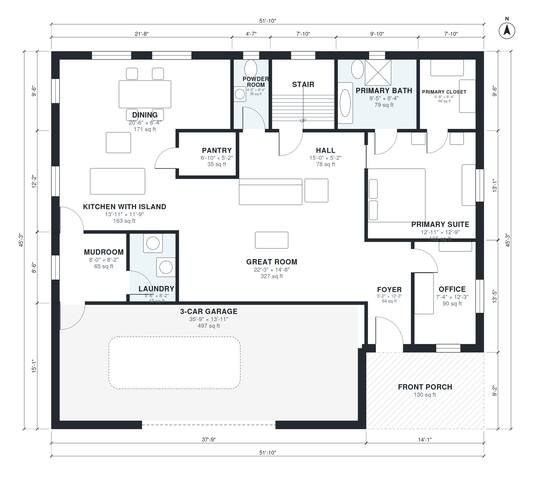

# Farmhouse Plans With 3 Car Garage: 3,230 Sq Ft, 4 Bed Plan

This is a two-story modern farmhouse with about 270 m² (roughly 2,900 sq ft) of living space, plus a 3-car garage and a front porch. The ground floor has an open great room, an island kitchen and dining, an office and a mudroom off the garage. The primary suite, with its bath and walk-in closet, is also on the ground floor. Upstairs are three bedrooms, two baths and a large bonus room.

| | |
|---|---|
| Levels | 2 |
| Footprint | 15.8 m × 13.8 m (52 ft × 45 ft) |
| Rooms | 24 indoor, 2 outdoor |
| Indoor area including garage, from the room grid | about 353 m² (3,799 sq ft) |

## Files here

- `area-schedule.csv` (room schedule)
- `building.json` (rooms, walls, openings as data)
- `plan-level1.dxf` (floor plan, DXF, drawing units: inches)
- `plan-level2.dxf` (floor plan, DXF, drawing units: inches)

## More for this plan

- Plan page with the PDF plan set, IFC and 3D model, and a tool to change the plan: https://floorplan.ai-architectures.com/house-plans/farmhouse-plans-with-3-car-garage?utm_source=github-plans&utm_medium=probe&utm_campaign=github
- PDF plan set: https://storage.googleapis.com/20img/house-plans/farmhouse-plans-with-3-car-garage/plan-set.pdf
- IFC model: https://storage.googleapis.com/20img/house-plans/farmhouse-plans-with-3-car-garage/model.ifc

## Known issues in this drawing

- Great Room has no window.
- Dining is only 2.54 m wide.

Concept design generated with AI. Not for construction or permit; verify with a licensed professional.
