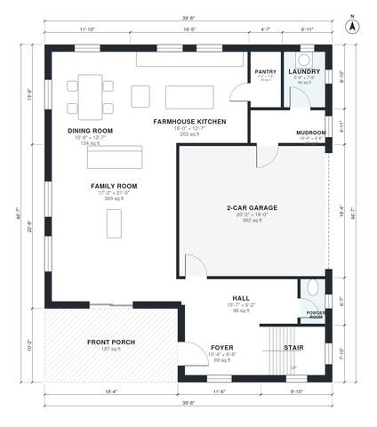

# Farmhouse Plans: 4-Bed, 2.5-Bath Two-Story, 2,450 Sq Ft

A traditional two-story farmhouse of about 240 m² (roughly 2,580 sq ft) of living space, plus a 2-car garage and a wide front porch under a gable roof. The ground floor has an open kitchen, dining and family room, a pantry, a powder room, and a mudroom and laundry off the garage. Upstairs, a primary suite with bath and walk-in closet and three bedrooms share a hall bath off a central hall.

| | |
|---|---|
| Levels | 2 |
| Footprint | 12.1 m × 14.2 m (40 ft × 47 ft) |
| Rooms | 21 indoor, 2 outdoor |
| Indoor area including garage, from the room grid | about 264 m² (2,840 sq ft) |

## Files here

- `area-schedule.csv` (room schedule)
- `building.json` (rooms, walls, openings as data)
- `plan-level1.dxf` (floor plan, DXF, drawing units: inches)
- `plan-level2.dxf` (floor plan, DXF, drawing units: inches)

## More for this plan

- Plan page with the PDF plan set, IFC and 3D model, and a tool to change the plan: https://floorplan.ai-architectures.com/house-plans/farmhouse-plans?utm_source=github-plans&utm_medium=probe&utm_campaign=github
- PDF plan set: https://storage.googleapis.com/20img/house-plans/farmhouse-plans/plan-set.pdf
- IFC model: https://storage.googleapis.com/20img/house-plans/farmhouse-plans/model.ifc

## Known issues in this drawing

- None found by the automatic checks.

Concept design generated with AI. Not for construction or permit; verify with a licensed professional.
