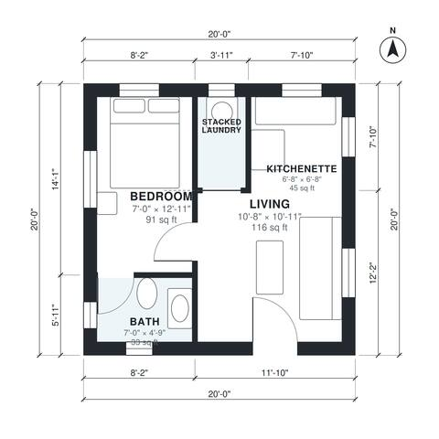

# Garage Conversion ADU Plans: 1-Bed, 1-Bath, 400 Sq Ft

This 20 x 20 ft garage conversion gives you a one-bedroom ADU of about 400 sq ft gross. The entry opens into an open living room and kitchenette. A bedroom with an attached bath sits on the quiet west side, and a stacked washer/dryer closet opens off the living room. It is a compact, efficient layout. The bath and bedroom are on the small side, so you can ask to trade a little living space for more room there.

| | |
|---|---|
| Levels | 1 |
| Footprint | 6.1 m × 6.1 m (20 ft × 20 ft) |
| Rooms | 5 indoor, 0 outdoor |
| Indoor area including garage, from the room grid | about 37 m² (401 sq ft) |

## Files here

- `area-schedule.csv` (room schedule)
- `building.json` (rooms, walls, openings as data)
- `plan-level1.dxf` (floor plan, DXF, drawing units: inches)

## More for this plan

- Plan page with the PDF plan set, IFC and 3D model, and a tool to change the plan: https://floorplan.ai-architectures.com/house-plans/garage-conversion-adu-plans?utm_source=github-plans&utm_medium=probe&utm_campaign=github
- PDF plan set: https://storage.googleapis.com/20img/house-plans/garage-conversion-adu-plans/plan-set.pdf
- IFC model: https://storage.googleapis.com/20img/house-plans/garage-conversion-adu-plans/model.ifc

## Known issues in this drawing

- Bath is 3.1 m² (asked for about 4.5 m²).
- Bedroom is only 2.14 m wide.
- Kitchenette is only 2.04 m wide.

Concept design generated with AI. Not for construction or permit; verify with a licensed professional.
