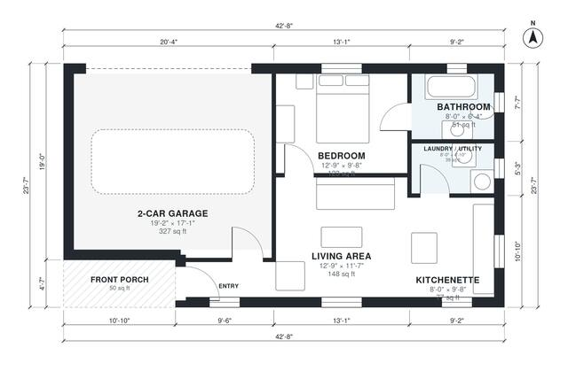

# Garage With Living Quarters House Plan, 570 Sq Ft, 1 Bed

This is a single-story detached building of about 43 ft by 24 ft. It has a 2-car garage on one side and a roughly 550 sq ft one-bedroom suite on the other, with a front porch at the entry. The suite has an open living area and kitchenette, a bedroom with a bath beside it, and a small laundry/utility room. The garage connects to the suite through the entry, so you can come in from either side.

| | |
|---|---|
| Levels | 1 |
| Footprint | 13.0 m × 7.2 m (43 ft × 24 ft) |
| Rooms | 7 indoor, 1 outdoor |
| Indoor area including garage, from the room grid | about 89 m² (958 sq ft) |

## Files here

- `area-schedule.csv` (room schedule)
- `building.json` (rooms, walls, openings as data)
- `plan-level1.dxf` (floor plan, DXF, drawing units: inches)

## More for this plan

- Plan page with the PDF plan set, IFC and 3D model, and a tool to change the plan: https://floorplan.ai-architectures.com/house-plans/garage-with-living-quarters?utm_source=github-plans&utm_medium=probe&utm_campaign=github
- PDF plan set: https://storage.googleapis.com/20img/house-plans/garage-with-living-quarters/plan-set.pdf
- IFC model: https://storage.googleapis.com/20img/house-plans/garage-with-living-quarters/model.ifc

## Known issues in this drawing

- Entry is 2.6 m² (asked for about 4.0 m²).
- Entry is only 1.04 m wide.
- 2-Car Garage is only 5.20 m wide.

Concept design generated with AI. Not for construction or permit; verify with a licensed professional.
