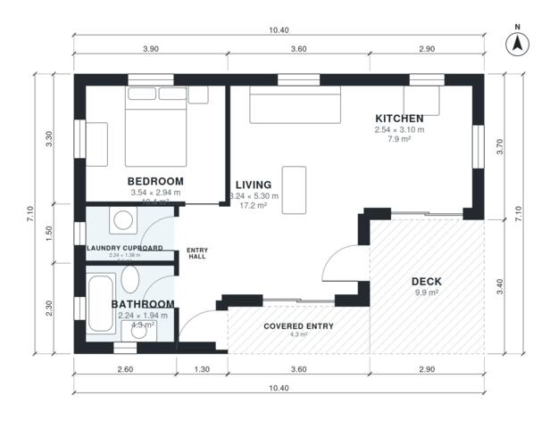

# Granny Flat Plans: 1 Bed, 1 Bath, 640 Sq Ft Single Story

This is a compact single-storey granny flat of about 56 m² of enclosed living space. A 4 m² covered entry and a 9.6 m² rear deck sit on the footprint of about 74 m². An entry hall leads to a private bedroom, a bathroom and a laundry cupboard. The open kitchen and living area has windows on two sides and a sliding door to the deck.

| | |
|---|---|
| Levels | 1 |
| Footprint | 10.4 m × 7.1 m (34 ft × 23 ft) |
| Rooms | 6 indoor, 2 outdoor |
| Indoor area including garage, from the room grid | about 60 m² (642 sq ft) |

## Files here

- `area-schedule.csv` (room schedule)
- `building.json` (rooms, walls, openings as data)
- `plan-level1.dxf` (floor plan, DXF, drawing units: millimetres)

## More for this plan

- Plan page with the PDF plan set, IFC and 3D model, and a tool to change the plan: https://floorplan.ai-architectures.com/house-plans/granny-flat-plans?utm_source=github-plans&utm_medium=probe&utm_campaign=github
- PDF plan set: https://storage.googleapis.com/20img/house-plans/granny-flat-plans/plan-set.pdf
- IFC model: https://storage.googleapis.com/20img/house-plans/granny-flat-plans/model.ifc

## Known issues in this drawing

- Kitchen is 7.9 m² (asked for about 11.0 m²).

Concept design generated with AI. Not for construction or permit; verify with a licensed professional.
