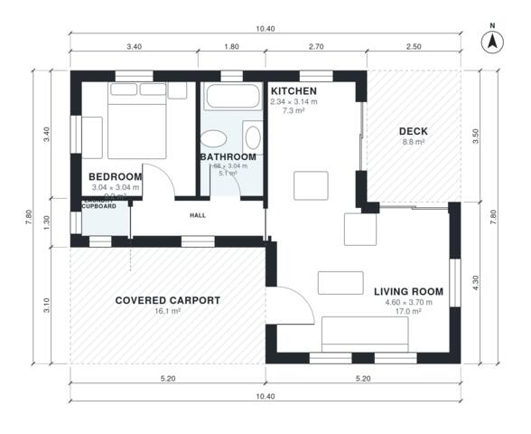

# Granny Flat With Carport Plans: 1 Bed, 1 Bath, 610 Sq Ft

A compact single-storey home of about 10.4 x 7.8 m, with roughly 50 m² of enclosed living space plus a rear deck and a 16 m² covered carport at the front. The open kitchen and living area is the main space, with a double bedroom, a bathroom and a laundry cupboard off a short hall. The deck opens from both the living room and the kitchen.

| | |
|---|---|
| Levels | 1 |
| Footprint | 10.4 m × 7.8 m (34 ft × 26 ft) |
| Rooms | 6 indoor, 2 outdoor |
| Indoor area including garage, from the room grid | about 56 m² (605 sq ft) |

## Files here

- `area-schedule.csv` (room schedule)
- `building.json` (rooms, walls, openings as data)
- `plan-level1.dxf` (floor plan, DXF, drawing units: millimetres)

## More for this plan

- Plan page with the PDF plan set, IFC and 3D model, and a tool to change the plan: https://floorplan.ai-architectures.com/house-plans/granny-flat-with-carport-plans?utm_source=github-plans&utm_medium=probe&utm_campaign=github
- PDF plan set: https://storage.googleapis.com/20img/house-plans/granny-flat-with-carport-plans/plan-set.pdf
- IFC model: https://storage.googleapis.com/20img/house-plans/granny-flat-with-carport-plans/model.ifc

## Known issues in this drawing

- Kitchen is 7.3 m² (asked for about 10.0 m²).

Concept design generated with AI. Not for construction or permit; verify with a licensed professional.
