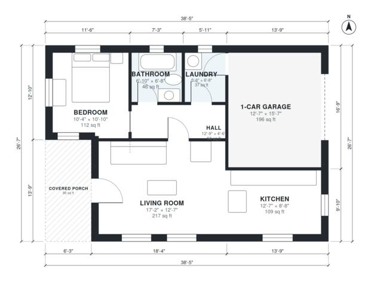

# Guest House Plans With Garage: 1 Bed, 1 Bath, 700 Sq Ft

This single-story guest house has about 65 m² (700 sq ft) of living space, plus a covered porch and an attached 1-car garage. You enter from the porch into an open living room and kitchen. A short hall leads to the bedroom, the full bath and the laundry, and the laundry connects to the garage. The compact rectangular shape keeps construction simple.

| | |
|---|---|
| Levels | 1 |
| Footprint | 11.7 m × 8.1 m (38 ft × 27 ft) |
| Rooms | 7 indoor, 1 outdoor |
| Indoor area including garage, from the room grid | about 87 m² (934 sq ft) |

## Files here

- `area-schedule.csv` (room schedule)
- `building.json` (rooms, walls, openings as data)
- `plan-level1.dxf` (floor plan, DXF, drawing units: inches)

## More for this plan

- Plan page with the PDF plan set, IFC and 3D model, and a tool to change the plan: https://floorplan.ai-architectures.com/house-plans/guest-house-plans-with-garage?utm_source=github-plans&utm_medium=probe&utm_campaign=github
- PDF plan set: https://storage.googleapis.com/20img/house-plans/guest-house-plans-with-garage/plan-set.pdf
- IFC model: https://storage.googleapis.com/20img/house-plans/guest-house-plans-with-garage/model.ifc

## Known issues in this drawing

- None found by the automatic checks.

Concept design generated with AI. Not for construction or permit; verify with a licensed professional.
