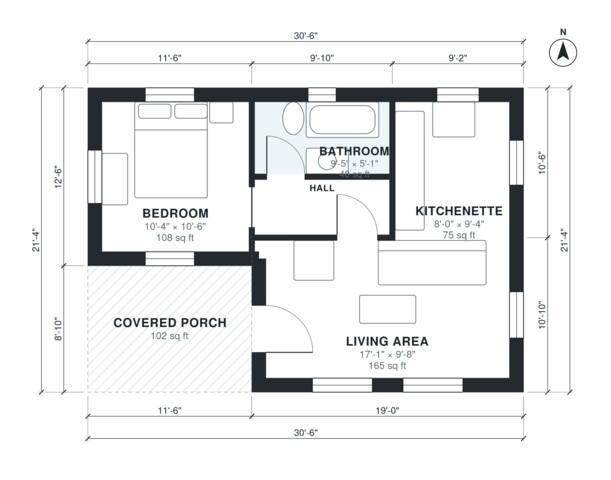

# Guest House Plans: 1 Bed, 1 Bath Single-Level, 550 Sq Ft

This is a compact single-storey guest house of about 550 sq ft of heated space, plus a roughly 100 sq ft covered porch. The porch leads into an open living and kitchenette area. A short hall gives the bedroom and full bath privacy from the living space. Every room has windows, and the bath shares a wall with the kitchenette to keep plumbing simple.

| | |
|---|---|
| Levels | 1 |
| Footprint | 9.3 m × 6.5 m (31 ft × 21 ft) |
| Rooms | 5 indoor, 1 outdoor |
| Indoor area including garage, from the room grid | about 51 m² (549 sq ft) |

## Files here

- `building.json` (rooms, walls, openings as data)
- `plan-level1.dxf` (floor plan, DXF, drawing units: inches)

## More for this plan

- Plan page with the PDF plan set, IFC and 3D model, and a tool to change the plan: https://floorplan.ai-architectures.com/house-plans/guest-house-plans?utm_source=github-plans&utm_medium=probe&utm_campaign=github
- PDF plan set: https://storage.googleapis.com/20img/house-plans/guest-house-plans/plan-set.pdf
- IFC model: https://storage.googleapis.com/20img/house-plans/guest-house-plans/model.ifc

## Known issues in this drawing

- Living Area is only 2.94 m wide.

Concept design generated with AI. Not for construction or permit; verify with a licensed professional.
