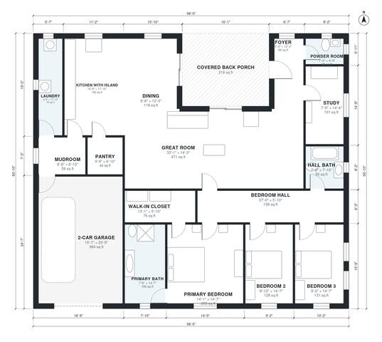

# Hill Country House Plans: 3 Bed, 2.5 Bath, 2,340 Sq Ft

This is a single-story Hill Country ranch of about 214 m² (2,300 sq ft) of living space, plus a 2-car garage and a deep covered back porch. A large open great room, island kitchen and dining area looks out to the porch. The front study sits off the foyer, and the primary suite and two bedrooms form a private wing off the bedroom hall. The garage enters through a mudroom with the laundry and pantry alongside.

| | |
|---|---|
| Levels | 1 |
| Footprint | 17.8 m × 15.5 m (58 ft × 51 ft) |
| Rooms | 17 indoor, 1 outdoor |
| Indoor area including garage, from the room grid | about 256 m² (2,754 sq ft) |

## Files here

- `area-schedule.csv` (room schedule)
- `building.json` (rooms, walls, openings as data)
- `plan-level1.dxf` (floor plan, DXF, drawing units: inches)

## More for this plan

- Plan page with the PDF plan set, IFC and 3D model, and a tool to change the plan: https://floorplan.ai-architectures.com/house-plans/hill-country-house-plans?utm_source=github-plans&utm_medium=probe&utm_campaign=github
- PDF plan set: https://storage.googleapis.com/20img/house-plans/hill-country-house-plans/plan-set.pdf
- IFC model: https://storage.googleapis.com/20img/house-plans/hill-country-house-plans/model.ifc

## Known issues in this drawing

- None found by the automatic checks.

Concept design generated with AI. Not for construction or permit; verify with a licensed professional.
