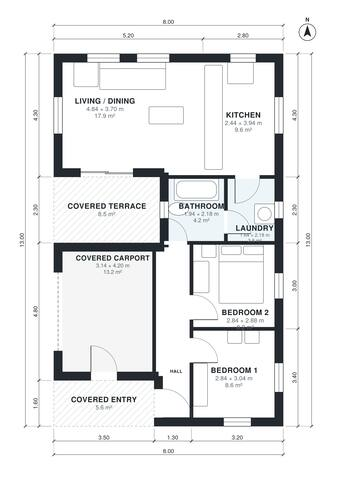

# House Plans for 10x20 Lot: 2-Bed, 1-Bath, 790 Sq Ft Plan

A compact single-storey home of about 72 m² of living space inside an 8 x 13 m envelope, plus a covered carport, covered entry and rear terrace. An open kitchen and living area opens onto the covered terrace, and two bedrooms, a bath and the laundry sit off a short hall. The revision widens the hall and kitchen and tries to put the carport next to the front entry.

| | |
|---|---|
| Levels | 1 |
| Footprint | 8.0 m × 13.0 m (26 ft × 43 ft) |
| Rooms | 8 indoor, 2 outdoor |
| Indoor area including garage, from the room grid | about 90 m² (968 sq ft) |

## Files here

- `area-schedule.csv` (room schedule)
- `building.json` (rooms, walls, openings as data)
- `plan-level1.dxf` (floor plan, DXF, drawing units: millimetres)

## More for this plan

- Plan page with the PDF plan set, IFC and 3D model, and a tool to change the plan: https://floorplan.ai-architectures.com/house-plans/house-plans-for-10x20-lot?utm_source=github-plans&utm_medium=probe&utm_campaign=github
- PDF plan set: https://storage.googleapis.com/20img/house-plans/house-plans-for-10x20-lot/plan-set.pdf
- IFC model: https://storage.googleapis.com/20img/house-plans/house-plans-for-10x20-lot/model.ifc

## Known issues in this drawing

- Hall and Living / Dining are not directly connected.
- Bedroom 1 is only 2.84 m wide.

Concept design generated with AI. Not for construction or permit; verify with a licensed professional.
