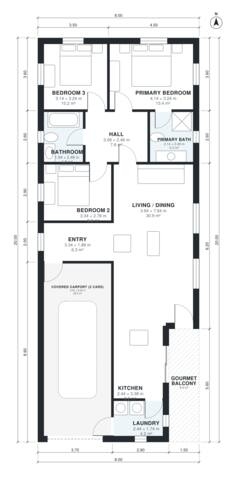

# House Plans for 10x30 Lot: 3-Bed, 2-Bath, 1,280 Sq Ft

A compact 8 x 20 m single-storey home with about 118 m² of living space, plus a covered 2-car carport at the front and a gourmet balcony at the back. The open kitchen, dining and living area is at the centre. The three bedrooms, including the primary suite, are grouped off a central hall. The revision gives the shared bathroom a proper hall door and better proportions, and brings Bedroom 2 closer to its target size.

| | |
|---|---|
| Levels | 1 |
| Footprint | 8.0 m × 20.0 m (26 ft × 66 ft) |
| Rooms | 11 indoor, 1 outdoor |
| Indoor area including garage, from the room grid | about 152 m² (1,632 sq ft) |

## Files here

- `area-schedule.csv` (room schedule)
- `building.json` (rooms, walls, openings as data)
- `plan-level1.dxf` (floor plan, DXF, drawing units: millimetres)

## More for this plan

- Plan page with the PDF plan set, IFC and 3D model, and a tool to change the plan: https://floorplan.ai-architectures.com/house-plans/house-plans-for-10x30-lot?utm_source=github-plans&utm_medium=probe&utm_campaign=github
- PDF plan set: https://storage.googleapis.com/20img/house-plans/house-plans-for-10x30-lot/plan-set.pdf
- IFC model: https://storage.googleapis.com/20img/house-plans/house-plans-for-10x30-lot/model.ifc

## Known issues in this drawing

- Kitchen is 8.2 m² (asked for about 12.0 m²).

Concept design generated with AI. Not for construction or permit; verify with a licensed professional.
