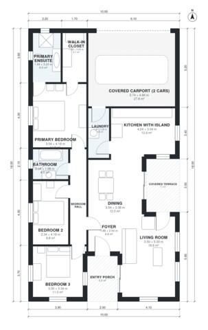

# House Plans for 12x25 Lot: 3 Bed, 2 Bath, 1,450 Sq Ft

A single-storey 3-bedroom, 2-bath house on a 10 x 18 m footprint, with about 130 m² of living space plus a covered carport, entry porch and covered terrace. The kitchen, dining and living area is open plan, and the primary suite has an ensuite and a walk-in closet. The revision widens the carport and the bedrooms so rooms are better proportioned and the house suits a narrow lot.

| | |
|---|---|
| Levels | 1 |
| Footprint | 10.0 m × 18.0 m (33 ft × 59 ft) |
| Rooms | 13 indoor, 2 outdoor |
| Indoor area including garage, from the room grid | about 166 m² (1,790 sq ft) |

## Files here

- `area-schedule.csv` (room schedule)
- `building.json` (rooms, walls, openings as data)
- `plan-level1.dxf` (floor plan, DXF, drawing units: millimetres)

## More for this plan

- Plan page with the PDF plan set, IFC and 3D model, and a tool to change the plan: https://floorplan.ai-architectures.com/house-plans/house-plans-for-12x25-lot?utm_source=github-plans&utm_medium=probe&utm_campaign=github
- PDF plan set: https://storage.googleapis.com/20img/house-plans/house-plans-for-12x25-lot/plan-set.pdf
- IFC model: https://storage.googleapis.com/20img/house-plans/house-plans-for-12x25-lot/model.ifc

## Known issues in this drawing

- Bedroom 2 is only 2.34 m wide.
- Covered carport (2 cars) is only 4.84 m wide.

Concept design generated with AI. Not for construction or permit; verify with a licensed professional.
