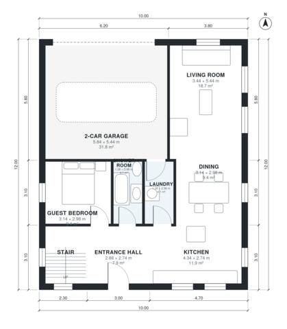

# House Plans for 12x30 Lot: 4-Bed, 2-Story, 1,830 Sq Ft

A compact two-storey house on a 10 m wide footprint, with about 170 m² of living space plus a 36 m² double garage. The ground floor has an open kitchen, dining and living area, a guest bedroom, a shower room and laundry. Upstairs are the primary suite, two bedrooms, a family bath and a roof terrace over the garage. The revision gives the garage a direct door to the kitchen, widens the bathrooms and secondary bedrooms, and shrinks the oversized primary bedroom.

| | |
|---|---|
| Levels | 2 |
| Footprint | 10.0 m × 12.0 m (33 ft × 39 ft) |
| Rooms | 17 indoor, 1 outdoor |
| Indoor area including garage, from the room grid | about 206 m² (2,215 sq ft) |

## Files here

- `area-schedule.csv` (room schedule)
- `building.json` (rooms, walls, openings as data)
- `plan-level1.dxf` (floor plan, DXF, drawing units: millimetres)
- `plan-level2.dxf` (floor plan, DXF, drawing units: millimetres)

## More for this plan

- Plan page with the PDF plan set, IFC and 3D model, and a tool to change the plan: https://floorplan.ai-architectures.com/house-plans/house-plans-for-12x30-lot?utm_source=github-plans&utm_medium=probe&utm_campaign=github
- PDF plan set: https://storage.googleapis.com/20img/house-plans/house-plans-for-12x30-lot/plan-set.pdf
- IFC model: https://storage.googleapis.com/20img/house-plans/house-plans-for-12x30-lot/model.ifc

## Known issues in this drawing

- Shower Room is only 1.38 m wide.
- Primary Bedroom is only 2.74 m wide.

Concept design generated with AI. Not for construction or permit; verify with a licensed professional.
