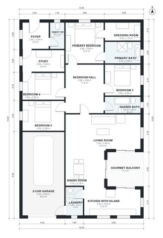

# House Plans for 15x30 Lot: 4-Bed, 1,960 Sq Ft One-Story

This is a single-storey, 12 x 19.2 m house with about 180 m² of living space plus a 38 m² two-car garage and a 12 m² gourmet balcony. The open kitchen with island, dining and living room face the balcony. The study and guest WC sit by the entrance. A central hall serves three bedrooms, a shared bath and the primary suite with its dressing room and ensuite. The garage connects to the kitchen through the laundry.

| | |
|---|---|
| Levels | 1 |
| Footprint | 12.0 m × 19.2 m (39 ft × 63 ft) |
| Rooms | 16 indoor, 1 outdoor |
| Indoor area including garage, from the room grid | about 219 m² (2,356 sq ft) |

## Files here

- `area-schedule.csv` (room schedule)
- `building.json` (rooms, walls, openings as data)
- `plan-level1.dxf` (floor plan, DXF, drawing units: millimetres)

## More for this plan

- Plan page with the PDF plan set, IFC and 3D model, and a tool to change the plan: https://floorplan.ai-architectures.com/house-plans/house-plans-for-15x30-lot?utm_source=github-plans&utm_medium=probe&utm_campaign=github
- PDF plan set: https://storage.googleapis.com/20img/house-plans/house-plans-for-15x30-lot/plan-set.pdf
- IFC model: https://storage.googleapis.com/20img/house-plans/house-plans-for-15x30-lot/model.ifc

## Known issues in this drawing

- None found by the automatic checks.

Concept design generated with AI. Not for construction or permit; verify with a licensed professional.
