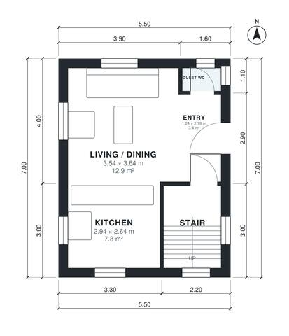

# House Plans for 8x15 Lot: 2-Bed, 830 Sq Ft Two-Story Plan

This is a compact two-storey townhouse of about 77 m² (5.5 x 7 m per floor) that fits the 6.5 m wide lot limit with no garage or basement. The ground floor has an entry, a guest WC, the stair and an open kitchen and living/dining area that is bright on three sides. Upstairs there are two bedrooms and a full bath off a small landing.

| | |
|---|---|
| Levels | 2 |
| Footprint | 5.5 m × 7.0 m (18 ft × 23 ft) |
| Rooms | 10 indoor, 0 outdoor |
| Indoor area including garage, from the room grid | about 77 m² (829 sq ft) |

## Files here

- `area-schedule.csv` (room schedule)
- `building.json` (rooms, walls, openings as data)
- `plan-level1.dxf` (floor plan, DXF, drawing units: millimetres)
- `plan-level2.dxf` (floor plan, DXF, drawing units: millimetres)

## More for this plan

- Plan page with the PDF plan set, IFC and 3D model, and a tool to change the plan: https://floorplan.ai-architectures.com/house-plans/house-plans-for-8x15-lot?utm_source=github-plans&utm_medium=probe&utm_campaign=github
- PDF plan set: https://storage.googleapis.com/20img/house-plans/house-plans-for-8x15-lot/plan-set.pdf
- IFC model: https://storage.googleapis.com/20img/house-plans/house-plans-for-8x15-lot/model.ifc

## Known issues in this drawing

- Landing and Bedroom 1 are not directly connected.
- Entry is only 1.24 m wide.
- Bedroom 1 is only 2.94 m wide.
- Bathroom is 3.2 m² (asked for about 5.0 m²).

Concept design generated with AI. Not for construction or permit; verify with a licensed professional.
