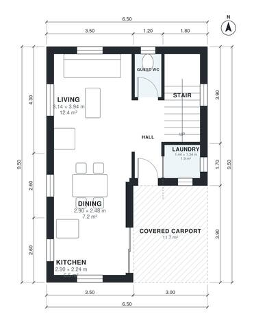

# House Plans for 8x20 Lot: 3-Bed, 2.5-Bath, 1,200 Sq Ft

A compact two-storey house on a 6.5 x 9.5 m footprint, with about 110 m² of living space plus a covered carport at the front. The ground floor has an open kitchen, dining and living area, a guest WC and a laundry. Upstairs are three bedrooms, a shared bath and a primary ensuite, now arranged off a wider hall so each bedroom opens onto it.

| | |
|---|---|
| Levels | 2 |
| Footprint | 6.5 m × 9.5 m (21 ft × 31 ft) |
| Rooms | 14 indoor, 1 outdoor |
| Indoor area including garage, from the room grid | about 112 m² (1,203 sq ft) |

## Files here

- `area-schedule.csv` (room schedule)
- `building.json` (rooms, walls, openings as data)
- `plan-level1.dxf` (floor plan, DXF, drawing units: millimetres)
- `plan-level2.dxf` (floor plan, DXF, drawing units: millimetres)

## More for this plan

- Plan page with the PDF plan set, IFC and 3D model, and a tool to change the plan: https://floorplan.ai-architectures.com/house-plans/house-plans-for-8x20-lot?utm_source=github-plans&utm_medium=probe&utm_campaign=github
- PDF plan set: https://storage.googleapis.com/20img/house-plans/house-plans-for-8x20-lot/plan-set.pdf
- IFC model: https://storage.googleapis.com/20img/house-plans/house-plans-for-8x20-lot/model.ifc

## Known issues in this drawing

- Dining is only 2.48 m wide.
- Laundry is 1.9 m² (asked for about 3.0 m²).
- Bedroom 2 is 7.2 m² (asked for about 10.0 m²).
- Bedroom 2 is only 2.04 m wide.
- Bedroom 3 is only 2.18 m wide.

Concept design generated with AI. Not for construction or permit; verify with a licensed professional.
