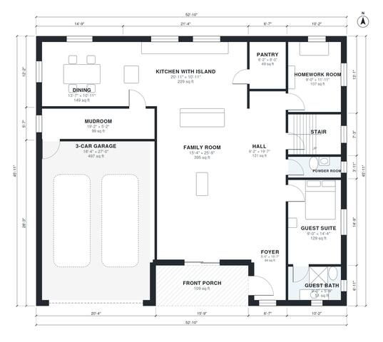

# House Plans for Large Families: 6 Bed, 3,900 Sq Ft, 2-Story

A two-story, six-bedroom farmhouse of about 353 m² (3,800 sq ft) of living space, plus a 3-car garage and a front porch. The ground floor has an open kitchen with a large island, a family room, dining, a homework room, a mudroom, a pantry and a guest suite with its own bath. Upstairs are the primary suite, four more bedrooms, two baths, laundry and a large playroom, all off one upper hall.

| | |
|---|---|
| Levels | 2 |
| Footprint | 16.1 m × 14.0 m (53 ft × 46 ft) |
| Rooms | 26 indoor, 2 outdoor |
| Indoor area including garage, from the room grid | about 416 m² (4,475 sq ft) |

## Files here

- `area-schedule.csv` (room schedule)
- `building.json` (rooms, walls, openings as data)
- `plan-level1.dxf` (floor plan, DXF, drawing units: inches)
- `plan-level2.dxf` (floor plan, DXF, drawing units: inches)

## More for this plan

- Plan page with the PDF plan set, IFC and 3D model, and a tool to change the plan: https://floorplan.ai-architectures.com/house-plans/house-plans-for-large-families?utm_source=github-plans&utm_medium=probe&utm_campaign=github
- PDF plan set: https://storage.googleapis.com/20img/house-plans/house-plans-for-large-families/plan-set.pdf
- IFC model: https://storage.googleapis.com/20img/house-plans/house-plans-for-large-families/model.ifc

## Known issues in this drawing

- Guest Bath is 4.8 m² (asked for about 7.0 m²).

Concept design generated with AI. Not for construction or permit; verify with a licensed professional.
