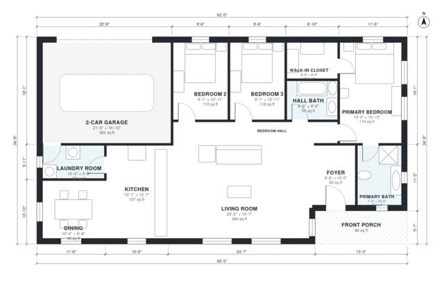

# House Plans With 2 Car Garage: 3 Bed, 2 Bath, 1,660 Sq Ft

This is a single-story ranch of about 153 m² (1,650 sq ft) of living space, plus an attached 2-car garage and a front porch. A large open kitchen, living and dining area sits at the front. The bedroom wing is along the back, with the primary suite (ensuite and walk-in closet) at one end and two bedrooms and a hall bath beside it. The laundry room connects the garage to the kitchen.

| | |
|---|---|
| Levels | 1 |
| Footprint | 18.9 m × 10.6 m (62 ft × 35 ft) |
| Rooms | 13 indoor, 1 outdoor |
| Indoor area including garage, from the room grid | about 192 m² (2,070 sq ft) |

## Files here

- `area-schedule.csv` (room schedule)
- `building.json` (rooms, walls, openings as data)
- `plan-level1.dxf` (floor plan, DXF, drawing units: inches)

## More for this plan

- Plan page with the PDF plan set, IFC and 3D model, and a tool to change the plan: https://floorplan.ai-architectures.com/house-plans/house-plans-with-2-car-garage?utm_source=github-plans&utm_medium=probe&utm_campaign=github
- PDF plan set: https://storage.googleapis.com/20img/house-plans/house-plans-with-2-car-garage/plan-set.pdf
- IFC model: https://storage.googleapis.com/20img/house-plans/house-plans-with-2-car-garage/model.ifc

## Known issues in this drawing

- None found by the automatic checks.

Concept design generated with AI. Not for construction or permit; verify with a licensed professional.
