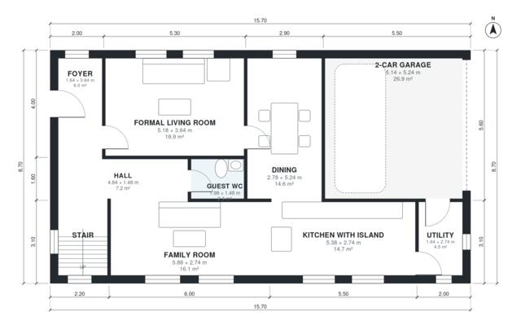

# House Plans With 2 Living Rooms: 2,220 Sq Ft, 4 Bed, 2.5 Bath

This is a compact two-storey family home of about 210 m² of living space, plus an attached garage of about 27 m². The ground floor has a foyer, a formal living room, an open kitchen with island, the family room and dining area, a guest WC and a utility room next to the garage. Upstairs, the primary suite with ensuite and walk-in closet sits beside three bedrooms and a family bath, all off one hall.

| | |
|---|---|
| Levels | 2 |
| Footprint | 15.7 m × 8.7 m (52 ft × 29 ft) |
| Rooms | 19 indoor, 1 outdoor |
| Indoor area including garage, from the room grid | about 237 m² (2,553 sq ft) |

## Files here

- `area-schedule.csv` (room schedule)
- `building.json` (rooms, walls, openings as data)
- `plan-level1.dxf` (floor plan, DXF, drawing units: millimetres)
- `plan-level2.dxf` (floor plan, DXF, drawing units: millimetres)

## More for this plan

- Plan page with the PDF plan set, IFC and 3D model, and a tool to change the plan: https://floorplan.ai-architectures.com/house-plans/house-plans-with-2-living-rooms?utm_source=github-plans&utm_medium=probe&utm_campaign=github
- PDF plan set: https://storage.googleapis.com/20img/house-plans/house-plans-with-2-living-rooms/plan-set.pdf
- IFC model: https://storage.googleapis.com/20img/house-plans/house-plans-with-2-living-rooms/model.ifc

## Known issues in this drawing

- Family Room is only 2.74 m wide.
- 2-Car Garage is 26.9 m² (asked for about 38.0 m²).
- Family Bath is 4.2 m² (asked for about 6.0 m²).

Concept design generated with AI. Not for construction or permit; verify with a licensed professional.
