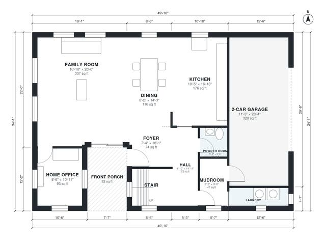

# House Plans With 2 Offices: 3 Bed, 2.5 Bath, 2,440 Sq Ft

This is a two-storey modern farmhouse of about 2,600 sq ft of living space, plus a 2-car garage and a front porch. The ground floor has an open kitchen, dining and family room, a front office, a powder room and a mudroom and laundry that connect to the garage. Upstairs are a primary suite with a walk-in closet, two more bedrooms, a hall bath, a second office and a loft, all off one central hall.

| | |
|---|---|
| Levels | 2 |
| Footprint | 15.2 m × 10.4 m (50 ft × 34 ft) |
| Rooms | 21 indoor, 2 outdoor |
| Indoor area including garage, from the room grid | about 261 m² (2,804 sq ft) |

## Files here

- `area-schedule.csv` (room schedule)
- `building.json` (rooms, walls, openings as data)
- `plan-level1.dxf` (floor plan, DXF, drawing units: inches)
- `plan-level2.dxf` (floor plan, DXF, drawing units: inches)

## More for this plan

- Plan page with the PDF plan set, IFC and 3D model, and a tool to change the plan: https://floorplan.ai-architectures.com/house-plans/house-plans-with-2-offices?utm_source=github-plans&utm_medium=probe&utm_campaign=github
- PDF plan set: https://storage.googleapis.com/20img/house-plans/house-plans-with-2-offices/plan-set.pdf
- IFC model: https://storage.googleapis.com/20img/house-plans/house-plans-with-2-offices/model.ifc

## Known issues in this drawing

- Laundry is 3.6 m² (asked for about 5.0 m²).
- Laundry is only 1.04 m wide.
- Dining is only 2.48 m wide.

Concept design generated with AI. Not for construction or permit; verify with a licensed professional.
