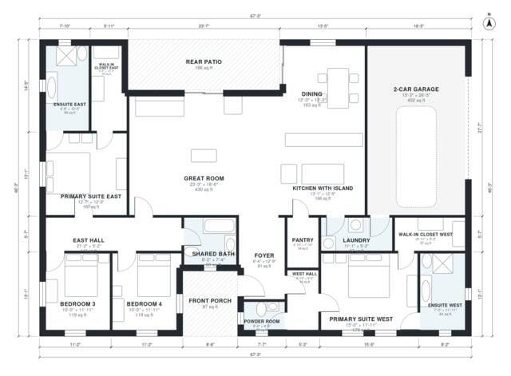

# House Plans With 2 Primary Suites: 4-Bed Single-Story Plan

This is a single-story ranch of about 2,400 sq ft (about 220 m²) of living space. A primary suite, each with a walk-in closet and ensuite, sits at each end of the house. The open great room, island kitchen and dining area connect to a rear patio. Two more bedrooms share a bath, and the 2-car garage connects through the laundry. The revision uses a wider, shallower footprint so the kitchen and bedrooms get windows and the great room is less narrow.

| | |
|---|---|
| Levels | 1 |
| Footprint | 20.5 m × 14.1 m (67 ft × 46 ft) |
| Rooms | 19 indoor, 2 outdoor |
| Indoor area including garage, from the room grid | about 264 m² (2,839 sq ft) |

## Files here

- `area-schedule.csv` (room schedule)
- `building.json` (rooms, walls, openings as data)
- `plan-level1.dxf` (floor plan, DXF, drawing units: inches)

## More for this plan

- Plan page with the PDF plan set, IFC and 3D model, and a tool to change the plan: https://floorplan.ai-architectures.com/house-plans/house-plans-with-2-primary-suites?utm_source=github-plans&utm_medium=probe&utm_campaign=github
- PDF plan set: https://storage.googleapis.com/20img/house-plans/house-plans-with-2-primary-suites/plan-set.pdf
- IFC model: https://storage.googleapis.com/20img/house-plans/house-plans-with-2-primary-suites/model.ifc

## Known issues in this drawing

- Kitchen with Island is 15.4 m² (asked for about 21.0 m²).
- Kitchen with Island has no window.

Concept design generated with AI. Not for construction or permit; verify with a licensed professional.
