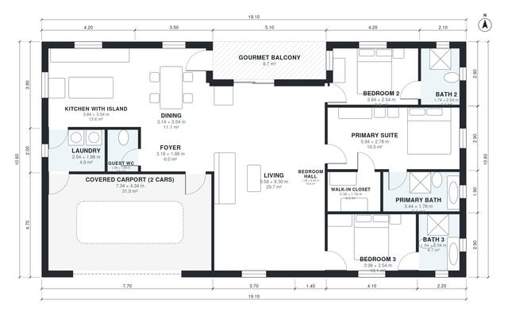

# House Plans With 3 Suites: 1,700 Sq Ft, 3 Bed, 3.5 Bath

This single-storey home has about 160 m² of living space on a 15.5 x 13 m footprint, plus a covered 2-car carport and a gourmet balcony. Three en-suite bedrooms sit along a private hall away from the open kitchen, dining and living area. A guest WC and laundry complete the plan, and the laundry doubles as the carport entry.

| | |
|---|---|
| Levels | 1 |
| Footprint | 19.1 m × 10.6 m (63 ft × 35 ft) |
| Rooms | 15 indoor, 1 outdoor |
| Indoor area including garage, from the room grid | about 194 m² (2,086 sq ft) |

## Files here

- `area-schedule.csv` (room schedule)
- `building.json` (rooms, walls, openings as data)
- `plan-level1.dxf` (floor plan, DXF, drawing units: millimetres)

## More for this plan

- Plan page with the PDF plan set, IFC and 3D model, and a tool to change the plan: https://floorplan.ai-architectures.com/house-plans/house-plans-with-3-suites?utm_source=github-plans&utm_medium=probe&utm_campaign=github
- PDF plan set: https://storage.googleapis.com/20img/house-plans/house-plans-with-3-suites/plan-set.pdf
- IFC model: https://storage.googleapis.com/20img/house-plans/house-plans-with-3-suites/model.ifc

## Known issues in this drawing

- Primary Suite is only 2.78 m wide.

Concept design generated with AI. Not for construction or permit; verify with a licensed professional.
