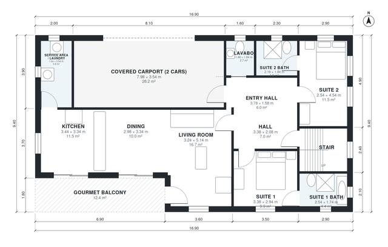

# House Plans With 4 Suites: 2,420 Sq Ft, 2-Story, 4.5 Bath

A compact two-storey house of about 159 m² per floor, with roughly 225 m² of living space excluding the carport, balcony and roof terrace. The ground floor has an open kitchen, dining and living area, a lavabo, a service area, a gourmet balcony and two en-suite bedrooms. The upper floor has two more suites, including a master with a walk-in closet, plus a family room, a study and a large roof terrace over the carport. A covered 2-car carport sits at the front.

| | |
|---|---|
| Levels | 2 |
| Footprint | 16.9 m × 9.4 m (55 ft × 31 ft) |
| Rooms | 22 indoor, 2 outdoor |
| Indoor area including garage, from the room grid | about 257 m² (2,764 sq ft) |

## Files here

- `area-schedule.csv` (room schedule)
- `building.json` (rooms, walls, openings as data)
- `plan-level1.dxf` (floor plan, DXF, drawing units: millimetres)
- `plan-level2.dxf` (floor plan, DXF, drawing units: millimetres)

## More for this plan

- Plan page with the PDF plan set, IFC and 3D model, and a tool to change the plan: https://floorplan.ai-architectures.com/house-plans/house-plans-with-4-suites?utm_source=github-plans&utm_medium=probe&utm_campaign=github
- PDF plan set: https://storage.googleapis.com/20img/house-plans/house-plans-with-4-suites/plan-set.pdf
- IFC model: https://storage.googleapis.com/20img/house-plans/house-plans-with-4-suites/model.ifc

## Known issues in this drawing

- Hall and Suite 2 are not directly connected.
- Service Area / Laundry is 5.8 m² (asked for about 8.0 m²).
- Suite 4 Bath is 4.4 m² (asked for about 6.0 m²).
- Master Suite is only 2.48 m wide.

Concept design generated with AI. Not for construction or permit; verify with a licensed professional.
