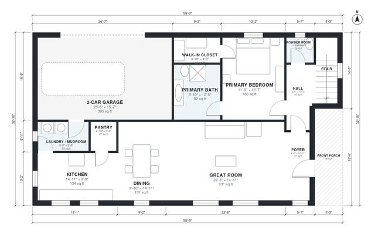

# House Plans With Bonus Room Over Garage | 2,410 Sq Ft, 3 Bed

This is a two-story modern farmhouse of about 225 m² (2,400 sq ft) of living space, plus an attached 2-car garage and a front porch. The ground floor has an open great room, kitchen and dining area, and a private primary suite with bath and walk-in closet. Upstairs are two bedrooms, a bath and a large bonus room.

| | |
|---|---|
| Levels | 2 |
| Footprint | 17.9 m × 10.0 m (59 ft × 33 ft) |
| Rooms | 19 indoor, 2 outdoor |
| Indoor area including garage, from the room grid | about 265 m² (2,853 sq ft) |

## Files here

- `area-schedule.csv` (room schedule)
- `building.json` (rooms, walls, openings as data)
- `plan-level1.dxf` (floor plan, DXF, drawing units: inches)
- `plan-level2.dxf` (floor plan, DXF, drawing units: inches)

## More for this plan

- Plan page with the PDF plan set, IFC and 3D model, and a tool to change the plan: https://floorplan.ai-architectures.com/house-plans/house-plans-with-bonus-room-over-garage?utm_source=github-plans&utm_medium=probe&utm_campaign=github
- PDF plan set: https://storage.googleapis.com/20img/house-plans/house-plans-with-bonus-room-over-garage/plan-set.pdf
- IFC model: https://storage.googleapis.com/20img/house-plans/house-plans-with-bonus-room-over-garage/model.ifc

## Known issues in this drawing

- Bedroom 3 is only 2.30 m wide.

Concept design generated with AI. Not for construction or permit; verify with a licensed professional.
