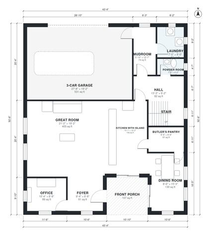

# House Plans With Butlers Pantry: 4-Bed, 3,160 Sq Ft Plan

This is a two-story, 4-bedroom, 3.5-bath modern farmhouse of about 300 m² (roughly 3,100-3,200 sq ft) of living space, plus an attached 3-car garage. The ground floor has a front porch, foyer, great room, island kitchen, butler's pantry, dining room, office, mudroom, laundry and powder room. Upstairs, the primary suite, three more bedrooms and a loft all open off a central hall.

| | |
|---|---|
| Levels | 2 |
| Footprint | 13.2 m × 15.4 m (43 ft × 51 ft) |
| Rooms | 23 indoor, 2 outdoor |
| Indoor area including garage, from the room grid | about 348 m² (3,749 sq ft) |

## Files here

- `area-schedule.csv` (room schedule)
- `building.json` (rooms, walls, openings as data)
- `plan-level1.dxf` (floor plan, DXF, drawing units: inches)
- `plan-level2.dxf` (floor plan, DXF, drawing units: inches)

## More for this plan

- Plan page with the PDF plan set, IFC and 3D model, and a tool to change the plan: https://floorplan.ai-architectures.com/house-plans/house-plans-with-butlers-pantry?utm_source=github-plans&utm_medium=probe&utm_campaign=github
- PDF plan set: https://storage.googleapis.com/20img/house-plans/house-plans-with-butlers-pantry/plan-set.pdf
- IFC model: https://storage.googleapis.com/20img/house-plans/house-plans-with-butlers-pantry/model.ifc

## Known issues in this drawing

- Dining Room is only 2.60 m wide.

Concept design generated with AI. Not for construction or permit; verify with a licensed professional.
