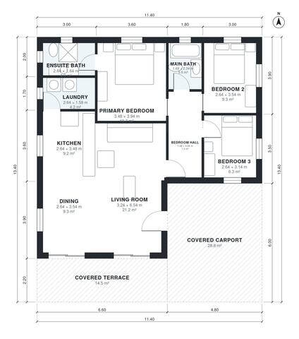

# House Plans With Carport: 3-Bed, 2-Bath, 1,180 Sq Ft Plan

This is a compact single-storey home with about 109 m² of indoor living space, 3 bedrooms and 2 baths, plus a covered 2-car carport at the front and a covered terrace. The kitchen, dining and living room form one open space that opens onto the terrace. The three bedrooms are grouped off a private hall at the back, and the primary bedroom has its own ensuite. The laundry is next to the kitchen.

| | |
|---|---|
| Levels | 1 |
| Footprint | 11.4 m × 13.4 m (37 ft × 44 ft) |
| Rooms | 10 indoor, 2 outdoor |
| Indoor area including garage, from the room grid | about 109 m² (1,178 sq ft) |

## Files here

- `area-schedule.csv` (room schedule)
- `building.json` (rooms, walls, openings as data)
- `plan-level1.dxf` (floor plan, DXF, drawing units: millimetres)

## More for this plan

- Plan page with the PDF plan set, IFC and 3D model, and a tool to change the plan: https://floorplan.ai-architectures.com/house-plans/house-plans-with-carport?utm_source=github-plans&utm_medium=probe&utm_campaign=github
- PDF plan set: https://storage.googleapis.com/20img/house-plans/house-plans-with-carport/plan-set.pdf
- IFC model: https://storage.googleapis.com/20img/house-plans/house-plans-with-carport/model.ifc

## Known issues in this drawing

- Bedroom 3 is 8.3 m² (asked for about 11.5 m²).

Concept design generated with AI. Not for construction or permit; verify with a licensed professional.
