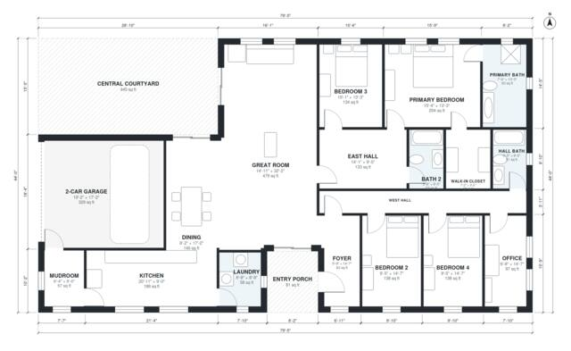

# House Plans With Courtyard: 4 Bed, 3 Bath, 2,590 Sq Ft

A single-story courtyard house of about 2,600 sq ft of living space, plus the garage, porch and courtyard. The foyer, great room, dining and kitchen sit on the south side of the courtyard, and the great room, dining and kitchen face it. The revision puts the primary suite on the east hall and moves Bedroom 4 to the west hall, so every room is reachable. It also gives the laundry and walk-in closet more usable size.

| | |
|---|---|
| Levels | 1 |
| Footprint | 24.2 m × 13.4 m (79 ft × 44 ft) |
| Rooms | 18 indoor, 2 outdoor |
| Indoor area including garage, from the room grid | about 275 m² (2,965 sq ft) |

## Files here

- `area-schedule.csv` (room schedule)
- `building.json` (rooms, walls, openings as data)
- `plan-level1.dxf` (floor plan, DXF, drawing units: inches)

## More for this plan

- Plan page with the PDF plan set, IFC and 3D model, and a tool to change the plan: https://floorplan.ai-architectures.com/house-plans/house-plans-with-courtyard?utm_source=github-plans&utm_medium=probe&utm_campaign=github
- PDF plan set: https://storage.googleapis.com/20img/house-plans/house-plans-with-courtyard/plan-set.pdf
- IFC model: https://storage.googleapis.com/20img/house-plans/house-plans-with-courtyard/model.ifc

## Known issues in this drawing

- Dining is only 2.48 m wide.
- Laundry is 5.4 m² (asked for about 8.0 m²).
- Great Room is only 4.54 m wide.

Concept design generated with AI. Not for construction or permit; verify with a licensed professional.
