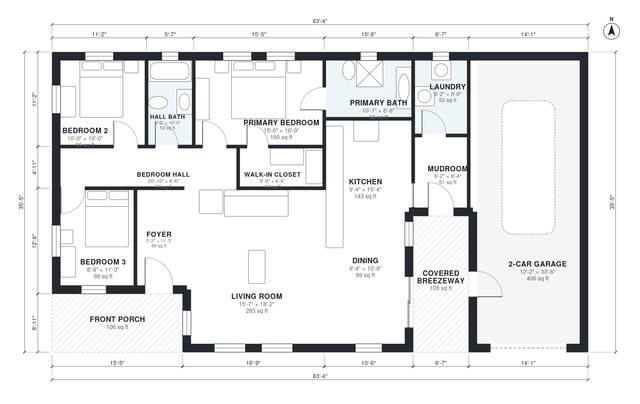

# House Plans with Detached Garage: 3 Bed, 1,530 Sq Ft Ranch

This single-story craftsman ranch has about 148 m² (1,600 sq ft) of living space. It has three bedrooms, two baths, a front porch, and an open kitchen, dining and living area. The primary suite has its own bath and walk-in closet, and the other two bedrooms share a hall bath. A covered breezeway runs from the mudroom (with laundry beside it) to a detached 2-car garage.

| | |
|---|---|
| Levels | 1 |
| Footprint | 19.3 m × 10.8 m (63 ft × 35 ft) |
| Rooms | 14 indoor, 2 outdoor |
| Indoor area including garage, from the room grid | about 189 m² (2,032 sq ft) |

## Files here

- `area-schedule.csv` (room schedule)
- `building.json` (rooms, walls, openings as data)
- `plan-level1.dxf` (floor plan, DXF, drawing units: inches)

## More for this plan

- Plan page with the PDF plan set, IFC and 3D model, and a tool to change the plan: https://floorplan.ai-architectures.com/house-plans/house-plans-with-detached-garage?utm_source=github-plans&utm_medium=probe&utm_campaign=github
- PDF plan set: https://storage.googleapis.com/20img/house-plans/house-plans-with-detached-garage/plan-set.pdf
- IFC model: https://storage.googleapis.com/20img/house-plans/house-plans-with-detached-garage/model.ifc

## Known issues in this drawing

- None found by the automatic checks.

Concept design generated with AI. Not for construction or permit; verify with a licensed professional.
