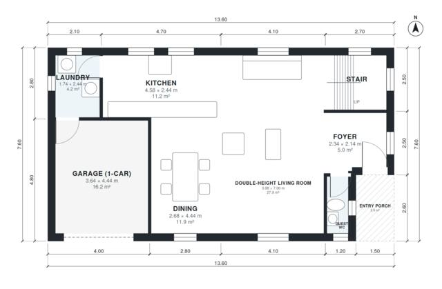

# House Plans With Double Height Living Room - 3 Bed, 2.5 Bath

A compact two-storey home of about 160 m² of living space, plus a 1-car attached garage. The ground floor has an open kitchen, dining and double-height living room, with a guest WC, laundry and foyer. Upstairs, a gallery serves the primary suite with ensuite and walk-in closet, two further bedrooms and a family bathroom.

| | |
|---|---|
| Levels | 2 |
| Footprint | 13.6 m × 7.6 m (45 ft × 25 ft) |
| Rooms | 16 indoor, 2 outdoor |
| Indoor area including garage, from the room grid | about 186 m² (2,002 sq ft) |

## Files here

- `area-schedule.csv` (room schedule)
- `building.json` (rooms, walls, openings as data)
- `plan-level1.dxf` (floor plan, DXF, drawing units: millimetres)
- `plan-level2.dxf` (floor plan, DXF, drawing units: millimetres)

## More for this plan

- Plan page with the PDF plan set, IFC and 3D model, and a tool to change the plan: https://floorplan.ai-architectures.com/house-plans/house-plans-with-double-height-living-room?utm_source=github-plans&utm_medium=probe&utm_campaign=github
- PDF plan set: https://storage.googleapis.com/20img/house-plans/house-plans-with-double-height-living-room/plan-set.pdf
- IFC model: https://storage.googleapis.com/20img/house-plans/house-plans-with-double-height-living-room/model.ifc

## Known issues in this drawing

- Guest WC is 1.9 m² (asked for about 3.0 m²).
- Guest WC is only 0.84 m wide.
- Foyer is 5.0 m² (asked for about 7.0 m²).

Concept design generated with AI. Not for construction or permit; verify with a licensed professional.
