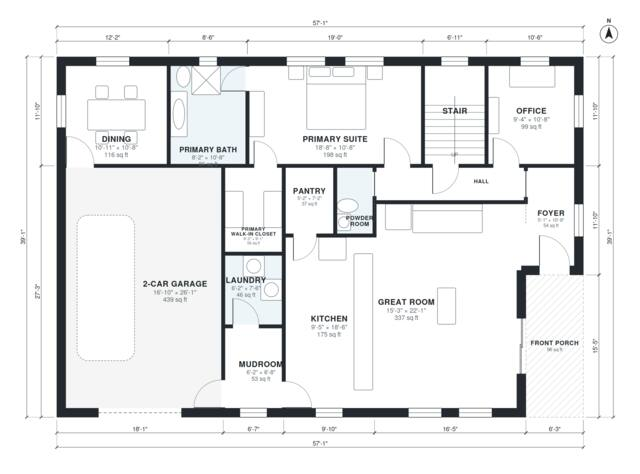

# House Plans With First Floor Master: 4 Bed, 2,860 Sq Ft

A two-story modern farmhouse of about 245 m² (roughly 2,650 sq ft) of living space, plus a 2-car garage and front porch. The ground floor has a first-floor primary suite, an open kitchen, dining and great room, a mudroom and laundry. Upstairs has three bedrooms, two baths and a playroom. After the revision the two floors are better balanced, so the upper rooms get fuller proportions.

| | |
|---|---|
| Levels | 2 |
| Footprint | 17.4 m × 11.9 m (57 ft × 39 ft) |
| Rooms | 24 indoor, 2 outdoor |
| Indoor area including garage, from the room grid | about 311 m² (3,352 sq ft) |

## Files here

- `area-schedule.csv` (room schedule)
- `building.json` (rooms, walls, openings as data)
- `plan-level1.dxf` (floor plan, DXF, drawing units: inches)
- `plan-level2.dxf` (floor plan, DXF, drawing units: inches)

## More for this plan

- Plan page with the PDF plan set, IFC and 3D model, and a tool to change the plan: https://floorplan.ai-architectures.com/house-plans/house-plans-with-first-floor-master?utm_source=github-plans&utm_medium=probe&utm_campaign=github
- PDF plan set: https://storage.googleapis.com/20img/house-plans/house-plans-with-first-floor-master/plan-set.pdf
- IFC model: https://storage.googleapis.com/20img/house-plans/house-plans-with-first-floor-master/model.ifc

## Known issues in this drawing

- Foyer is 5.0 m² (asked for about 7.0 m²).
- Bath 3 is 3.9 m² (asked for about 6.0 m²).

Concept design generated with AI. Not for construction or permit; verify with a licensed professional.
