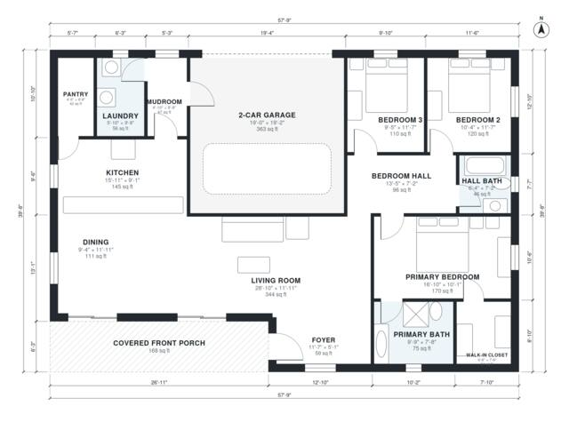

# House Plans with Front Porch: 3 Bed, 2 Bath, 1,730 Sq Ft

This is a single-story 3-bedroom, 2-bath ranch with about 156 m² (1,680 sq ft) of living space, plus a 40 m² two-car garage and a covered porch. It has an open kitchen, dining and living area, a separate primary suite with a walk-in closet, and a garage entered through a mudroom and laundry. The porch and the secondary bedroom proportions need adjusting to match the brief.

| | |
|---|---|
| Levels | 1 |
| Footprint | 17.6 m × 12.1 m (58 ft × 40 ft) |
| Rooms | 15 indoor, 1 outdoor |
| Indoor area including garage, from the room grid | about 197 m² (2,125 sq ft) |

## Files here

- `area-schedule.csv` (room schedule)
- `building.json` (rooms, walls, openings as data)
- `plan-level1.dxf` (floor plan, DXF, drawing units: inches)

## More for this plan

- Plan page with the PDF plan set, IFC and 3D model, and a tool to change the plan: https://floorplan.ai-architectures.com/house-plans/house-plans-with-front-porch?utm_source=github-plans&utm_medium=probe&utm_campaign=github
- PDF plan set: https://storage.googleapis.com/20img/house-plans/house-plans-with-front-porch/plan-set.pdf
- IFC model: https://storage.googleapis.com/20img/house-plans/house-plans-with-front-porch/model.ifc

## Known issues in this drawing

- None found by the automatic checks.

Concept design generated with AI. Not for construction or permit; verify with a licensed professional.
