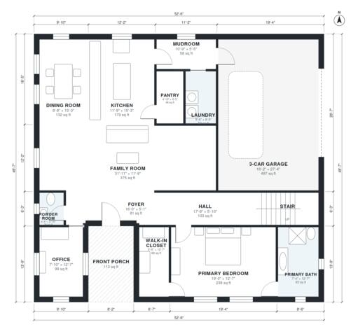

# House Plans With Game Room: 3,310 Sq Ft, 4 Bed, 3.5 Bath

This two-story traditional farmhouse has about 298 m² (3,200 sq ft) of living space, plus a 3-car garage that enters through the mudroom beside the kitchen. The ground floor has the primary suite with bath and walk-in closet, an office, a powder room, and an open kitchen, dining and family area behind a front porch and foyer. Upstairs there are three bedrooms, two baths and a large game room off a central hall.

| | |
|---|---|
| Levels | 2 |
| Footprint | 16.0 m × 14.8 m (52 ft × 49 ft) |
| Rooms | 24 indoor, 2 outdoor |
| Indoor area including garage, from the room grid | about 359 m² (3,865 sq ft) |

## Files here

- `area-schedule.csv` (room schedule)
- `building.json` (rooms, walls, openings as data)
- `plan-level1.dxf` (floor plan, DXF, drawing units: inches)
- `plan-level2.dxf` (floor plan, DXF, drawing units: inches)

## More for this plan

- Plan page with the PDF plan set, IFC and 3D model, and a tool to change the plan: https://floorplan.ai-architectures.com/house-plans/house-plans-with-game-room?utm_source=github-plans&utm_medium=probe&utm_campaign=github
- PDF plan set: https://storage.googleapis.com/20img/house-plans/house-plans-with-game-room/plan-set.pdf
- IFC model: https://storage.googleapis.com/20img/house-plans/house-plans-with-game-room/model.ifc

## Known issues in this drawing

- Bath 3 is 4.1 m² (asked for about 6.5 m²).
- Bedroom 3 is 10.3 m² (asked for about 14.0 m²).

Concept design generated with AI. Not for construction or permit; verify with a licensed professional.
