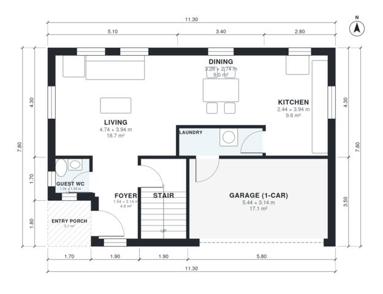

# House Plans With Garage in Front: 3-Bed, 2.5-Bath, 1,430 Sq Ft

A compact two-storey home of about 135 m² of living space, with a 1-car front garage that is not counted in that figure. The ground floor has an open kitchen, dining and living area, a foyer, a guest WC and a laundry that links the house to the garage. Upstairs, three bedrooms and a family bath open off a central hall, and the primary bedroom has its own ensuite.

| | |
|---|---|
| Levels | 2 |
| Footprint | 11.3 m × 7.8 m (37 ft × 26 ft) |
| Rooms | 15 indoor, 2 outdoor |
| Indoor area including garage, from the room grid | about 153 m² (1,646 sq ft) |

## Files here

- `area-schedule.csv` (room schedule)
- `building.json` (rooms, walls, openings as data)
- `plan-level1.dxf` (floor plan, DXF, drawing units: millimetres)
- `plan-level2.dxf` (floor plan, DXF, drawing units: millimetres)

## More for this plan

- Plan page with the PDF plan set, IFC and 3D model, and a tool to change the plan: https://floorplan.ai-architectures.com/house-plans/house-plans-with-garage-in-front?utm_source=github-plans&utm_medium=probe&utm_campaign=github
- PDF plan set: https://storage.googleapis.com/20img/house-plans/house-plans-with-garage-in-front/plan-set.pdf
- IFC model: https://storage.googleapis.com/20img/house-plans/house-plans-with-garage-in-front/model.ifc

## Known issues in this drawing

- Guest WC is 1.8 m² (asked for about 3.0 m²).
- Laundry is only 1.08 m wide.

Concept design generated with AI. Not for construction or permit; verify with a licensed professional.
