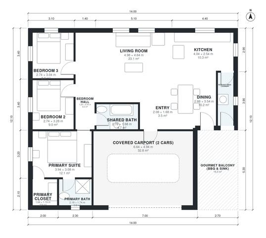

# House Plans with Gourmet Balcony: 3 Bed, 1,270 Sq Ft

This is a single-storey house of about 120 m² of living space. It has an open kitchen, dining and living area, a primary suite with ensuite and closet, two more bedrooms and a shared bath. A covered 2-car carport sits at the front and a covered gourmet balcony with barbecue and sink at the back, beside the service area. The bedroom hall and the closet and laundry are too narrow and need adjusting.

| | |
|---|---|
| Levels | 1 |
| Footprint | 14.0 m × 12.1 m (46 ft × 40 ft) |
| Rooms | 13 indoor, 1 outdoor |
| Indoor area including garage, from the room grid | about 155 m² (1,669 sq ft) |

## Files here

- `area-schedule.csv` (room schedule)
- `building.json` (rooms, walls, openings as data)
- `plan-level1.dxf` (floor plan, DXF, drawing units: millimetres)

## More for this plan

- Plan page with the PDF plan set, IFC and 3D model, and a tool to change the plan: https://floorplan.ai-architectures.com/house-plans/house-plans-with-gourmet-balcony?utm_source=github-plans&utm_medium=probe&utm_campaign=github
- PDF plan set: https://storage.googleapis.com/20img/house-plans/house-plans-with-gourmet-balcony/plan-set.pdf
- IFC model: https://storage.googleapis.com/20img/house-plans/house-plans-with-gourmet-balcony/model.ifc

## Known issues in this drawing

- Dining has no window.
- Service Area / Laundry is 3.7 m² (asked for about 6.0 m²).
- Service Area / Laundry is only 1.04 m wide.

Concept design generated with AI. Not for construction or permit; verify with a licensed professional.
