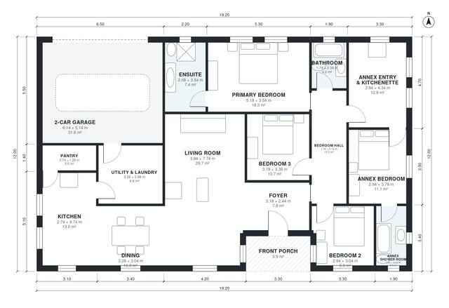

# House Plans With Granny Annex: 4 Bed, 3 Bath, 2,030 Sq Ft

A compact single-storey home of about 188 m² of living space plus a 38 m² attached 2-car garage. The main house has three bedrooms, including a primary suite with ensuite, and an open kitchen, dining and living area. A self-contained granny annex has its own entry, kitchenette, bedroom and shower room. The revision gives the rooms less elongated proportions and combines the utility and laundry into one back-entry room beside the garage.

| | |
|---|---|
| Levels | 1 |
| Footprint | 19.2 m × 12.0 m (63 ft × 39 ft) |
| Rooms | 16 indoor, 1 outdoor |
| Indoor area including garage, from the room grid | about 224 m² (2,416 sq ft) |

## Files here

- `area-schedule.csv` (room schedule)
- `building.json` (rooms, walls, openings as data)
- `plan-level1.dxf` (floor plan, DXF, drawing units: millimetres)

## More for this plan

- Plan page with the PDF plan set, IFC and 3D model, and a tool to change the plan: https://floorplan.ai-architectures.com/house-plans/house-plans-with-granny-annex?utm_source=github-plans&utm_medium=probe&utm_campaign=github
- PDF plan set: https://storage.googleapis.com/20img/house-plans/house-plans-with-granny-annex/plan-set.pdf
- IFC model: https://storage.googleapis.com/20img/house-plans/house-plans-with-granny-annex/model.ifc

## Known issues in this drawing

- Bedroom 3 has no window.
- Bedroom 3 needs an egress window (min. 0.53 m² / 5.7 sq ft opening).
- Bedroom 2 is 8.9 m² (asked for about 12.0 m²).
- Bathroom is 4.2 m² (asked for about 6.0 m²).

Concept design generated with AI. Not for construction or permit; verify with a licensed professional.
