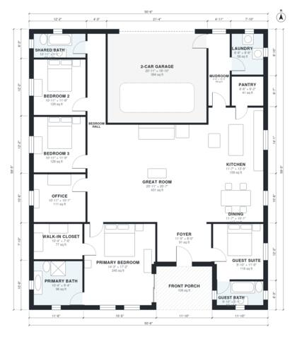

# House Plans With Guest Suite: 4-Bed, 3-Bath Single Story

This is a single-story, 4-bedroom, 3-bath farmhouse-style plan. It has about 230 m² (2,500 sq ft) of living space plus a 2-car garage and a front porch. The guest suite and its bath are near the entry, the great room, open kitchen and dining area sit in the middle, and the primary suite is at the back. I'm adjusting the plan so the entry connects directly to the great room and the office and primary bedroom get better proportions.

| | |
|---|---|
| Levels | 1 |
| Footprint | 15.4 m × 18.1 m (51 ft × 59 ft) |
| Rooms | 18 indoor, 1 outdoor |
| Indoor area including garage, from the room grid | about 269 m² (2,892 sq ft) |

## Files here

- `area-schedule.csv` (room schedule)
- `building.json` (rooms, walls, openings as data)
- `plan-level1.dxf` (floor plan, DXF, drawing units: inches)

## More for this plan

- Plan page with the PDF plan set, IFC and 3D model, and a tool to change the plan: https://floorplan.ai-architectures.com/house-plans/house-plans-with-guest-suite?utm_source=github-plans&utm_medium=probe&utm_campaign=github
- PDF plan set: https://storage.googleapis.com/20img/house-plans/house-plans-with-guest-suite/plan-set.pdf
- IFC model: https://storage.googleapis.com/20img/house-plans/house-plans-with-guest-suite/model.ifc

## Known issues in this drawing

- Great Room has no window.

Concept design generated with AI. Not for construction or permit; verify with a licensed professional.
