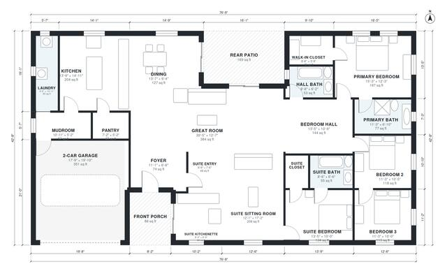

# House Plans with In-Law Suite: 4-Bed Single-Story, 2,610 Sq Ft

This single-story modern farmhouse is about 2,600 sq ft of living area. It has a central great room open to the kitchen and dining, a bedroom wing with a primary suite plus two bedrooms and a hall bath, and a 2-car garage with a mudroom and laundry. The attached in-law suite has its own entry, sitting room, kitchenette, bedroom and bath. The revision gives the dining area a direct open link to the living space and simplifies the bedroom hall.

| | |
|---|---|
| Levels | 1 |
| Footprint | 23.4 m × 13.0 m (77 ft × 43 ft) |
| Rooms | 21 indoor, 2 outdoor |
| Indoor area including garage, from the room grid | about 281 m² (3,019 sq ft) |

## Files here

- `area-schedule.csv` (room schedule)
- `building.json` (rooms, walls, openings as data)
- `plan-level1.dxf` (floor plan, DXF, drawing units: inches)

## More for this plan

- Plan page with the PDF plan set, IFC and 3D model, and a tool to change the plan: https://floorplan.ai-architectures.com/house-plans/house-plans-with-in-law-suite?utm_source=github-plans&utm_medium=probe&utm_campaign=github
- PDF plan set: https://storage.googleapis.com/20img/house-plans/house-plans-with-in-law-suite/plan-set.pdf
- IFC model: https://storage.googleapis.com/20img/house-plans/house-plans-with-in-law-suite/model.ifc

## Known issues in this drawing

- Bedroom Hall and Bedroom 3 are not directly connected.
- Bedroom 3 is only reachable through another bedroom.

Concept design generated with AI. Not for construction or permit; verify with a licensed professional.
