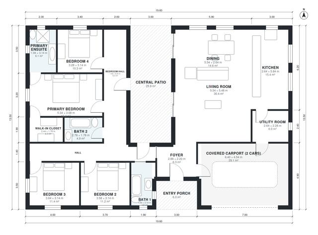

# House Plans with Inner Courtyard: 4 Bed, 3 Bath, 2,130 Sq Ft

A single-storey courtyard-style home with about 203 m² of living space, plus a 29 m² covered 2-car carport, a porch and a 26 m² central patio. The open kitchen, dining and 32 m² living room face the patio. The four bedrooms, including a primary suite with ensuite and walk-in closet, sit along a private hall wing with two shared baths. A utility room links the kitchen to the carport.

| | |
|---|---|
| Levels | 1 |
| Footprint | 19.6 m × 13.5 m (64 ft × 44 ft) |
| Rooms | 16 indoor, 2 outdoor |
| Indoor area including garage, from the room grid | about 232 m² (2,503 sq ft) |

## Files here

- `area-schedule.csv` (room schedule)
- `building.json` (rooms, walls, openings as data)
- `plan-level1.dxf` (floor plan, DXF, drawing units: millimetres)

## More for this plan

- Plan page with the PDF plan set, IFC and 3D model, and a tool to change the plan: https://floorplan.ai-architectures.com/house-plans/house-plans-with-inner-courtyard?utm_source=github-plans&utm_medium=probe&utm_campaign=github
- PDF plan set: https://storage.googleapis.com/20img/house-plans/house-plans-with-inner-courtyard/plan-set.pdf
- IFC model: https://storage.googleapis.com/20img/house-plans/house-plans-with-inner-courtyard/model.ifc

## Known issues in this drawing

- None found by the automatic checks.

Concept design generated with AI. Not for construction or permit; verify with a licensed professional.
