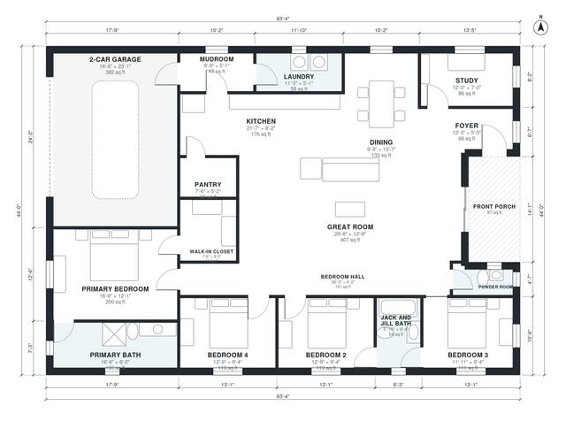

# House Plans With Jack and Jill Bathroom: 4-Bed, 2,260 Sq Ft

This is a single-storey, four-bedroom, 2.5-bath modern farmhouse of about 209 m² (2,250 sq ft) of living space, plus a 2-car garage and a front porch. The kitchen, dining area and great room form one open space at the centre. The primary suite with bath and walk-in closet is at the back, and the other bedrooms are along a hall, with two of them sharing a Jack and Jill bath. A study at the front, a pantry, and a mudroom and laundry on the garage side finish the plan.

| | |
|---|---|
| Levels | 1 |
| Footprint | 19.3 m × 13.4 m (63 ft × 44 ft) |
| Rooms | 18 indoor, 1 outdoor |
| Indoor area including garage, from the room grid | about 250 m² (2,687 sq ft) |

## Files here

- `area-schedule.csv` (room schedule)
- `building.json` (rooms, walls, openings as data)
- `plan-level1.dxf` (floor plan, DXF, drawing units: inches)

## More for this plan

- Plan page with the PDF plan set, IFC and 3D model, and a tool to change the plan: https://floorplan.ai-architectures.com/house-plans/house-plans-with-jack-and-jill-bathroom?utm_source=github-plans&utm_medium=probe&utm_campaign=github
- PDF plan set: https://storage.googleapis.com/20img/house-plans/house-plans-with-jack-and-jill-bathroom/plan-set.pdf
- IFC model: https://storage.googleapis.com/20img/house-plans/house-plans-with-jack-and-jill-bathroom/model.ifc

## Known issues in this drawing

- Front Porch is not on the street side.
- Kitchen has no window.

Concept design generated with AI. Not for construction or permit; verify with a licensed professional.
