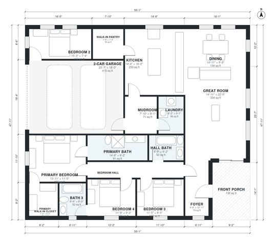

# House Plans With Large Kitchen: 4-Bed, 2,060 Sq Ft Ranch

A single-story 4-bedroom, 3-bath farmhouse of about 233 m² (2,500 sq ft) of living space, plus a 2-car garage and a front porch. An open great room, dining and a very large kitchen with a long island and a walk-in pantry sit on one side. The bedroom wing opens off the foyer on the other, with a primary suite that has a bath and a walk-in closet. A mudroom and laundry link the garage to the kitchen.

| | |
|---|---|
| Levels | 1 |
| Footprint | 16.8 m × 14.6 m (55 ft × 48 ft) |
| Rooms | 17 indoor, 1 outdoor |
| Indoor area including garage, from the room grid | about 233 m² (2,511 sq ft) |

## Files here

- `area-schedule.csv` (room schedule)
- `building.json` (rooms, walls, openings as data)
- `plan-level1.dxf` (floor plan, DXF, drawing units: inches)

## More for this plan

- Plan page with the PDF plan set, IFC and 3D model, and a tool to change the plan: https://floorplan.ai-architectures.com/house-plans/house-plans-with-large-kitchen?utm_source=github-plans&utm_medium=probe&utm_campaign=github
- PDF plan set: https://storage.googleapis.com/20img/house-plans/house-plans-with-large-kitchen/plan-set.pdf
- IFC model: https://storage.googleapis.com/20img/house-plans/house-plans-with-large-kitchen/model.ifc

## Known issues in this drawing

- Bedroom Hall and Bedroom 2 are not directly connected.
- Bedroom 2 is only 2.24 m wide.

Concept design generated with AI. Not for construction or permit; verify with a licensed professional.
